# Email Analysis – Lab Report

**Platform:** TryHackMe
**Topic:** Email protocols, email headers, attachments and phishing analysis
**Tools used:** Mozilla Thunderbird, Text editor, CyberChef
**Status:** Room completed

---

## 1. Objective

The goal of this room was to understand how email works and how to investigate suspicious emails. This included learning the main email protocols, reading raw email headers, decoding attachments, and spotting phishing attempts.

---

## 2. Task 3 – Email Protocols

### What I learned

When an email is sent, three main protocols work together:

| Protocol | Full Name | Job |
|---|---|---|
| SMTP | Simple Mail Transfer Protocol | Sends emails |
| POP3 | Post Office Protocol | Downloads emails to one device |
| IMAP | Internet Message Access Protocol | Syncs emails across many devices |

**POP3 vs IMAP**

| POP3 | IMAP |
|---|---|
| Emails stored on one device | Emails stay on the server |
| Usually deleted from server after download | Kept on server until deleted |
| Access from one device only | Access from many devices |

### An email's journey

1. The sender's email client sends the message to its mail server using **SMTP**.
2. The sending server asks **DNS** where the recipient's mail server is.
3. DNS replies with the recipient mail server's address.
4. The email travels across the Internet to the recipient's server.
5. The recipient's email client connects to its mail server.
6. The email is downloaded (**POP3**) or synced (**IMAP**) to the recipient's device.

### Answers

| Question | Answer |
|---|---|
| Which protocol sends an email from a client to a mail server? | **SMTP** |
| Which service looks up the recipient domain's mail server? | **DNS** |
| Bob wants email on his phone and laptop. Which protocol? | **IMAP** |

---

## 3. Task 4 – Reading Email Headers (`email1.eml`)

### Steps performed

1. Opened the **Email Samples** folder.
2. Opened `email1.eml` in **Thunderbird**.
3. Viewed the raw email source (**Ctrl + U**) to see the full headers.

**Evidence – Email Samples folder**

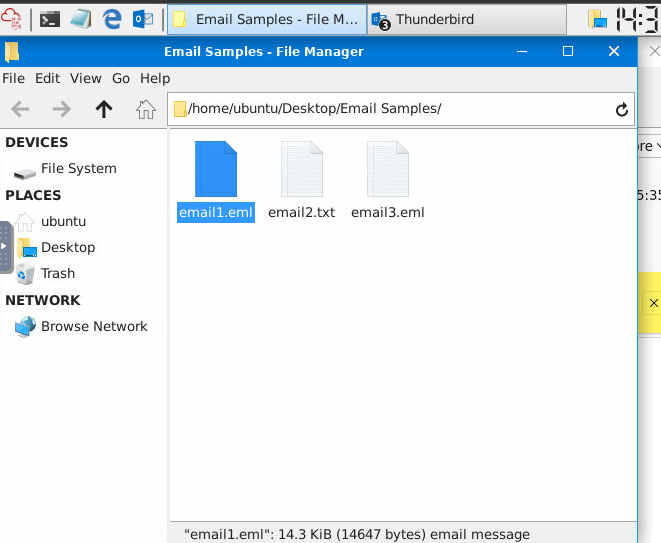

**Evidence – email1.eml opened in Thunderbird**

**Evidence – Raw email source**

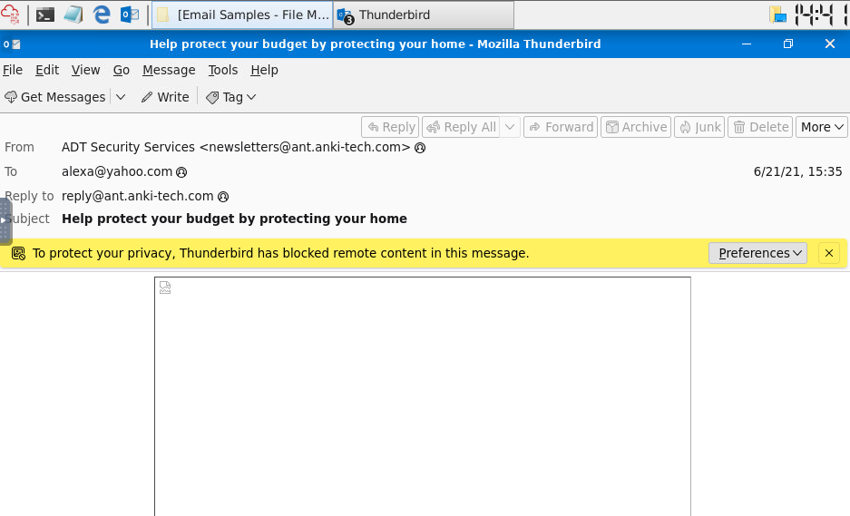

### Answers

| Question | Answer |
|---|---|
| Full subject line of `email1.eml` | *Help protect your budget by protecting your home* |
| `X-Originating-IP` address | *10.222.142.150* |

**Evidence – Subject line**

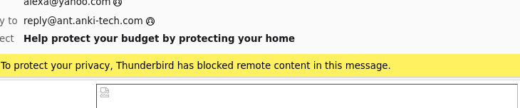

**Evidence – X-Originating-IP**

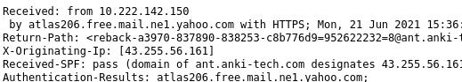

---

## 4. Task 5 – Analysing an Attachment (`email2.txt`)

### Steps performed

1. Opened `email2.txt`.
2. Found the attachment's **Content-Type** and **filename** in the MIME section.
3. Copied the **Base64-encoded** attachment data.
4. Decoded the Base64 in **CyberChef** to reveal the PDF contents.

**Evidence – Attachment details in email2.txt**

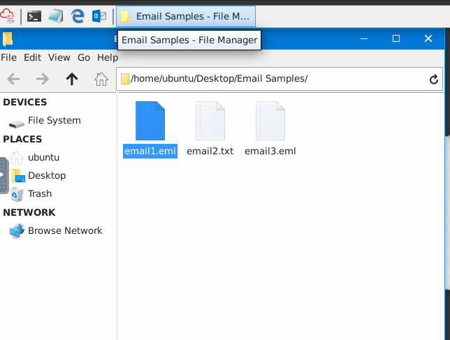

**Evidence – Base64 data**

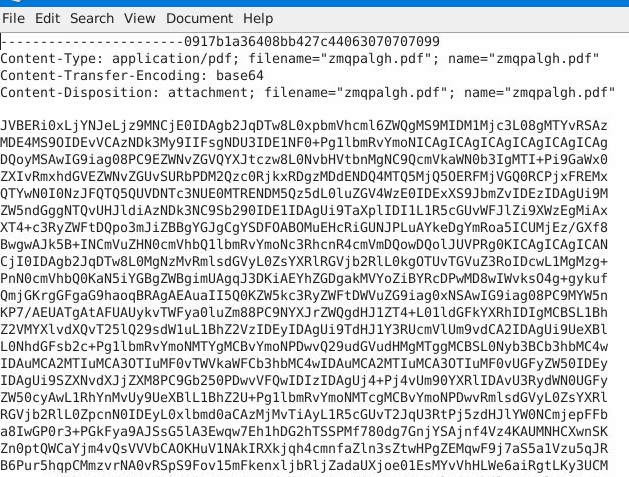

**Evidence – Decoding in CyberChef**
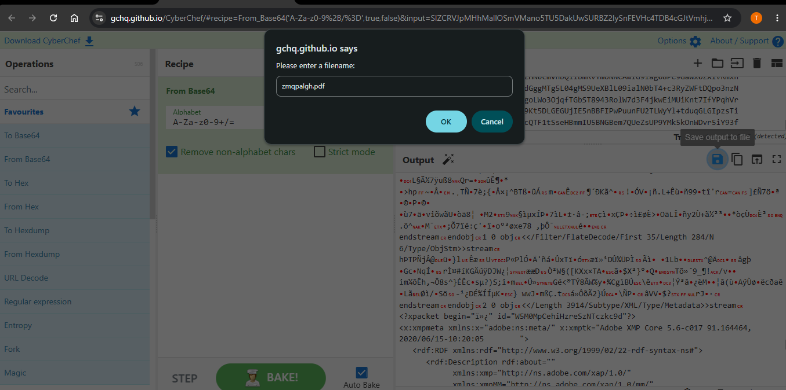

### Answers

| Question | Answer |
|---|---|
| Content-Type of the attachment | **application/pdf** |
| Name of the attachment | **zmqpalgh.pdf** |
| Hidden flag value | **THM{BENIGN_PDF_ATTACHMENT}** |

**Evidence – Content-Type**

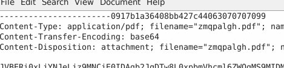

**Evidence – Filename**

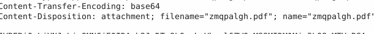

**Evidence – Flag**

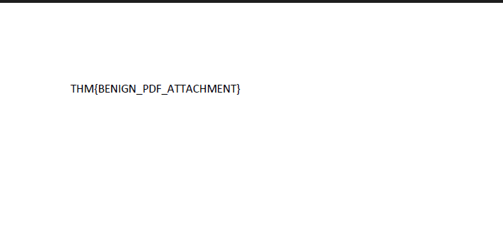

---

## 5. Task 6 – Phishing Analysis (`email3.eml`)

### Steps performed

1. Opened `email3.eml` in **Thunderbird**.
2. Read the email to identify which company was being impersonated.
3. Opened the message source (**Ctrl + U**) to check the headers.
4. Checked the sender address, originating IP and authentication results.

**Evidence – email3.eml opened**

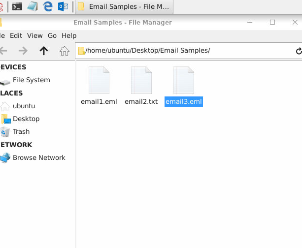
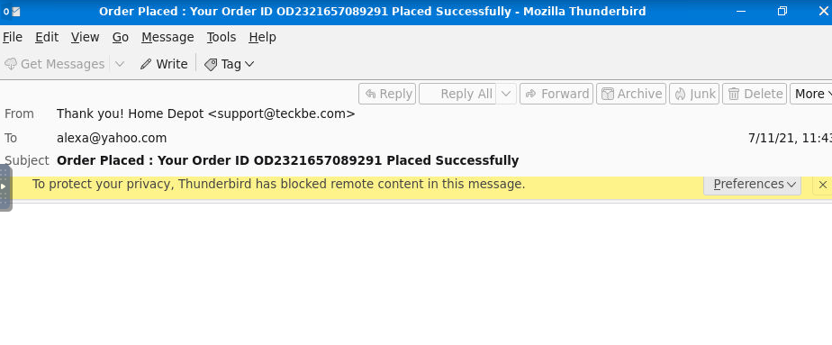

**Evidence – Message source**

### Answers

| Question | Answer |
|---|---|
| Organisation being spoofed | **Home Depot** |
| Sender's email address | **support@teckbe.com** |
| Defanged `X-Originating-IP` | **103[.]234[.]236[.]83** |
| Server that created the `Authentication-Results` header | **atlas102.free.mail.gq1.yahoo.com** |

**Evidence – Spoofed organisation**

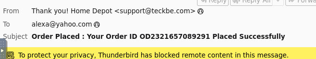

**Evidence – Sender address**

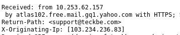

**Evidence – X-Originating-IP**

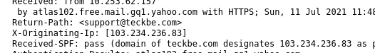

**Evidence – Authentication-Results**

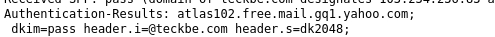

### Red flags noticed

- The email claims to be from **Home Depot**, but the sender domain is **teckbe.com**, which has nothing to do with Home Depot.
- The originating IP does not belong to Home Depot's infrastructure.
- Both are classic signs of a **spoofed / phishing** email.

---

## 6. Business Email Compromise (BEC)

**Business Email Compromise (BEC)** is an attack where a criminal takes over a real internal email account and uses it to trick employees into fraud, such as sending money or sharing sensitive data. Because the email comes from a genuine account, it is harder to detect.

| Question | Answer |
|---|---|
| What attack, shortened to BEC, uses a compromised email to trick employees into fraud? | **Business Email Compromise** |

---

## 7. Conclusion

In this room I learned how email travels from sender to receiver and the role of SMTP, POP3, IMAP and DNS. I practised reading raw email headers in Thunderbird, decoding a Base64 attachment with CyberChef, and analysing a phishing email that impersonated Home Depot. I also learned about Business Email Compromise. All tasks were completed successfully.

**Evidence – Room completed**

